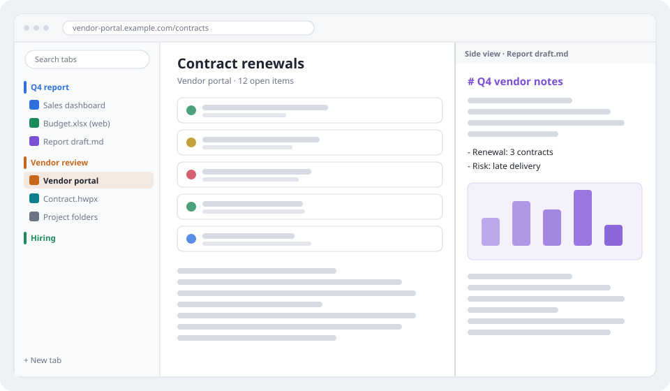
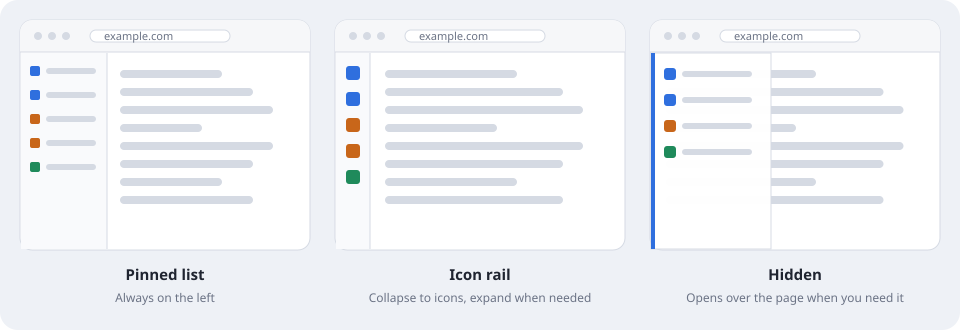
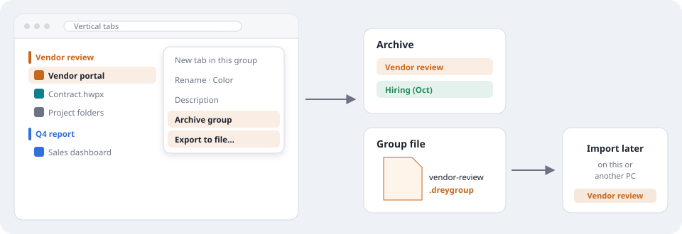
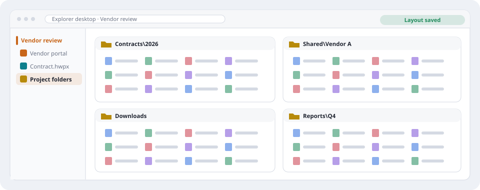
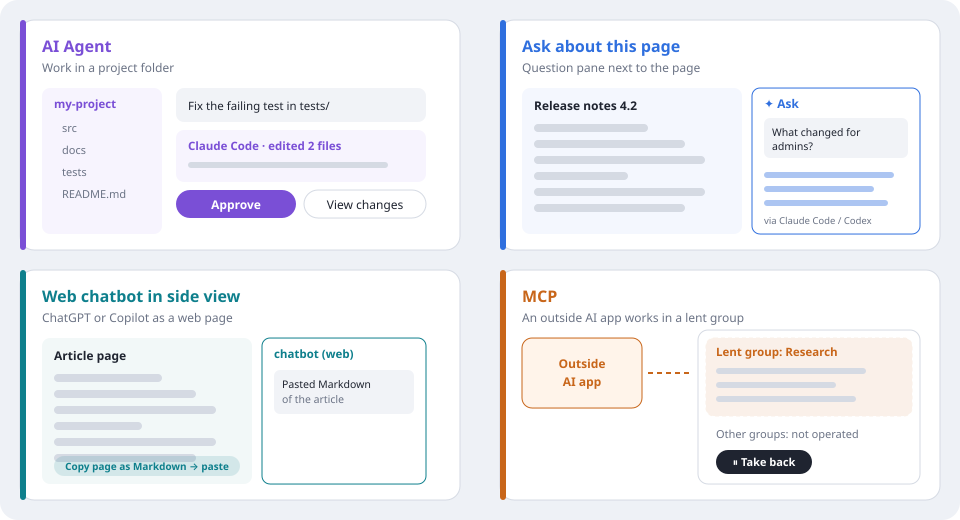
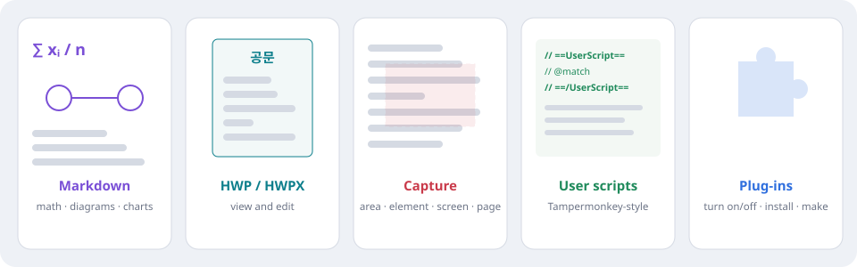

# Drey Browser

**English** · [한국어](README.ko.md) · [Detailed tour](site/index.html) (a local page — GitHub shows the HTML as source; download the repository and open `site/index.html` in a browser)

A Windows browser for work. Keep the web pages, documents, folders and AI help for one job together — in groups on a vertical tab list, with the page area left wide open.

- **Start right away** — no Drey account, sign-in or sync. Websites and AI services still use their own sign-in.
- **Keep work separate** — use it next to your personal browser, so work tabs, bookmarks and history stay apart.
- **Your data stays on this PC** — settings, history and groups are kept in your Windows user profile.

Built on the Microsoft Edge WebView2 (Chromium) engine. The pictures on this page are drawn examples, not screenshots.

**On this page:** [Vertical tabs](#1-vertical-tabs-wide-pages) · [Work groups & side view](#2-work-groups-and-the-side-view) · [Explorer desktop](#3-explorer-desktop) · [AI, four ways](#4-ai-four-different-ways) · [Documents & extensions](#5-documents-and-extensions) · [Getting started](#getting-started) · [Good to know](#good-to-know)

## 1. Vertical tabs, wide pages

Tabs always live in a list on the left. There is no horizontal tab strip, so the page gets the full height of the window.

- **Pinned list** — names and groups stay in view. Good on a wide monitor.
- **Icon rail** — collapse the list to icons and expand it again when you need names.
- **Hidden** — the list stays out of the way and opens over the page when you need it (button, left edge, or shortcut). Good on a narrow or tall window.
- **Search tabs** at the top of the list finds a tab by title or address.

## 2. Work groups and the side view

Put everything for one job in a **group** with a name, a color and an optional description.

*Example — reviewing a vendor:* the "Vendor review" group holds the vendor portal, the contract in the Hangul editor and the project folders. The "Q4 report" group holds the dashboard and your notes. Collapse a group you are not using, and the list stays short.

- **Side view** — open a second page next to the current one (see the right side of the first picture): read the contract while you fill in the portal, or keep notes open while you read.
- **Archive group** — finished for now? Archive it. Its tabs close, and you can bring the group back later.
- **Export to file** — save a group as a `.dreygroup` file and import it later on this or another PC. Files inside folders and website passwords are not included.

## 3. Explorer desktop

Arrange several File Explorer folders inside a single tab — the contract folder, the shared folder, downloads and reports — and keep that layout with the work group.

*Example:* open "Project folders" in the Vendor review group and the same four folders come back where you left them. The layout is saved as a record; folders are not copied and their permissions do not change.

## 4. AI, four different ways

Each AI feature does a different job. Pick the one that fits:

| Feature | What it is for | How it works |
|---|---|---|
| **AI Agent** | Work in a project folder with Claude Code or Codex | Open a folder as a workspace, talk to the agent, review its file changes, approve or deny actions, and keep work documents. |
| **Ask about this page (✦)** | A quick question about the page you are reading | The page text and your question go to Claude Code or Codex on this PC, and the answer appears in a pane next to the page. |
| **Web chatbot in the side view** | Keep ChatGPT or Copilot open beside your work | It is the chatbot's ordinary web page. It does **not** read your page by itself — use “Copy page as Markdown” and paste it in. |
| **MCP** (Model Context Protocol) | Let an outside AI app use the browser | The app can read tabs and operate only inside a tab group you lend it. Press ⏸ to take control back at any time. |

AI Agent and Ask need the Claude Code or Codex command-line tool installed separately and signed in with your own account. Usage and fees follow that service.

## 5. Documents and extensions

- **Markdown** — read and edit `.md` files in a tab, with math, diagrams and charts. *Example:* keep the report draft from picture 1 open in the side view.
- **Hangul (HWP/HWPX)** — open and edit Korean word-processor documents in a tab.
- **Text and hex** — a code/text editor and a hex editor for quick fixes.
- **Capture** — capture an area, an element, the visible screen or the full page, then copy or save it.
- **User scripts** — run Tampermonkey-style scripts and import Tampermonkey backups. Most common GM APIs work, but it is not a full Tampermonkey replacement, and scripts do not run on built-in pages such as Settings.
- **Plug-ins** — the editors above are built-in plug-ins. Turn them on or off, install plug-in files, or build your own with the developer docs in Settings > Plug-ins.

## Getting started

1. Install Drey Browser and open it. Choose 한국어 or English on first run; a short feature guide opens once (you can reopen it from Settings > About).
2. Make a group for one job and add its tabs. Try the side view and the tab list layouts in Settings.
3. For AI Agent or Ask, install Claude Code or Codex and sign in with your own account.

## Good to know

- **What you send to AI** — page content sent with Ask, a web chatbot or MCP goes to that AI service. Don't send pages with passwords or personal data. Sites on the AI-excluded list are never read or operated over MCP.
- **Terms and privacy** — see [Terms of Use and Privacy Notice](TERMS.md) (effective 2026-11-07). Questions: [Issues](https://github.com/TRpop/DreyBrowserRelease/issues).
- **Installer** — the installer is not code-signed, so Windows may show a warning.
- **Source code** — the application source is not published. Open-source notices are in the app (Settings > About > Open-source licenses) and in `THIRD-PARTY-NOTICES.txt`.
- **Skills** — the built-in agent skills are MIT-licensed; their source repository is [TRpop/DreySkills](https://github.com/TRpop/DreySkills).
