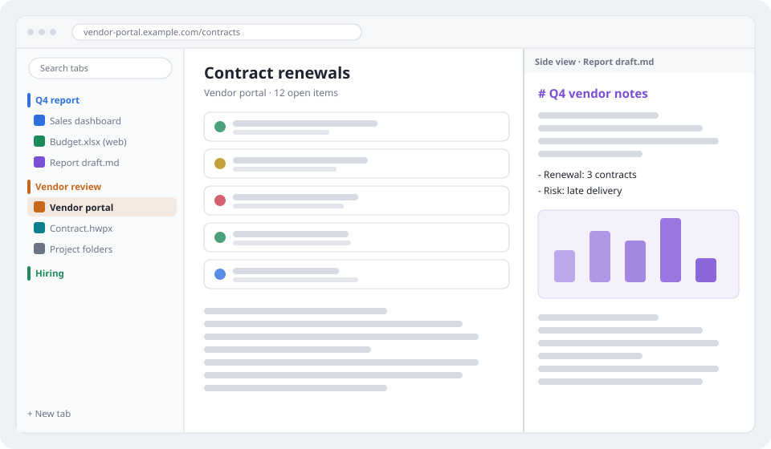
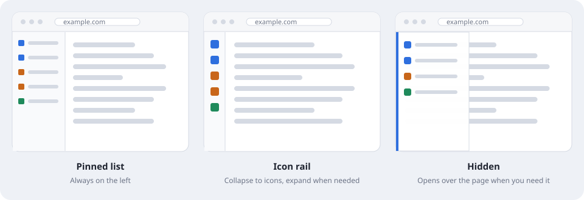
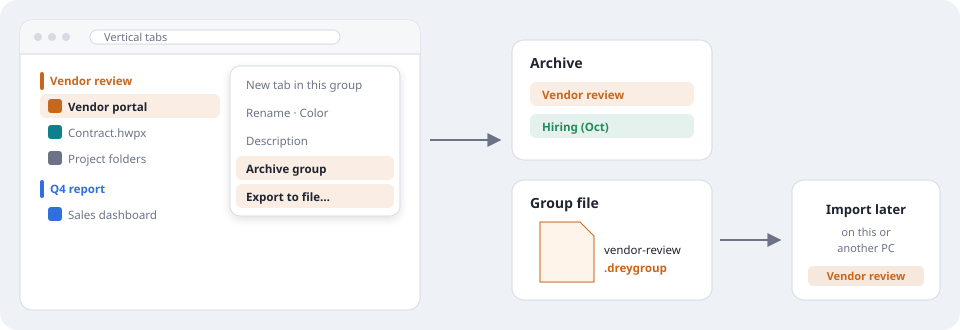
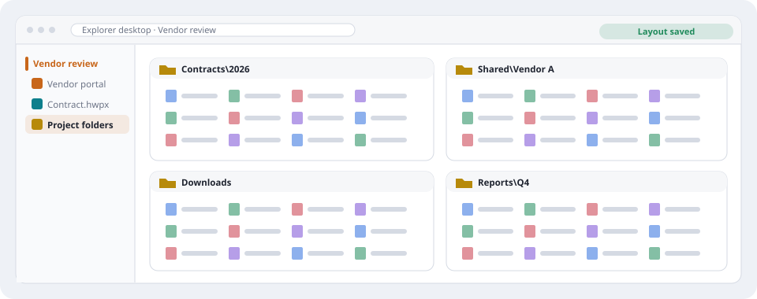
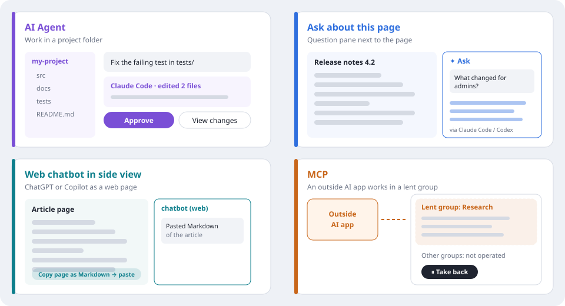
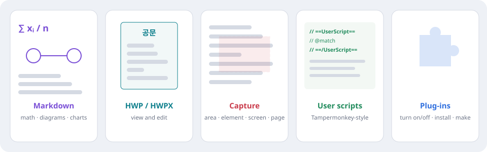

# Drey Browser

[English](README.en.md) · **한국어** · [자세한 둘러보기](site/ko.html) (로컬 페이지 — GitHub 에서는 HTML 이 코드로 보입니다. 저장소를 내려받아 `site/ko.html` 을 브라우저로 여세요)

일을 위한 Windows 브라우저입니다. 한 가지 일에 필요한 웹 페이지·문서·폴더·AI 도움을 세로 탭 목록의 그룹으로 함께 두고, 페이지 영역은 넓게 씁니다.

- **바로 시작** — Drey 계정·로그인·동기화가 없습니다. 웹사이트와 AI 서비스는 각자의 로그인을 그대로 씁니다.
- **업무를 따로** — 개인 브라우저와 함께 써서 업무 탭·북마크·기록을 나눠 둡니다.
- **자료는 이 PC 에** — 설정·기록·그룹은 Windows 사용자 프로필에 저장됩니다.

Microsoft Edge WebView2(Chromium) 엔진을 씁니다. 이 페이지의 그림은 설명용으로 그린 예시이며 실제 화면을 찍은 것이 아닙니다(그림 속 글은 짧은 영어 예시).

**목차:** [세로 탭](#1-세로-탭-넓은-페이지) · [업무 그룹과 사이드뷰](#2-업무-그룹과-사이드뷰) · [탐색기 데스크톱](#3-탐색기-데스크톱) · [AI 네 가지](#4-ai-네-가지-방법) · [문서와 확장](#5-문서와-확장) · [시작하기](#시작하기) · [알아 둘 것](#알아-둘-것)

## 1. 세로 탭, 넓은 페이지

탭은 언제나 왼쪽 목록에 있습니다. 가로 탭 줄이 없어서 페이지가 창 높이를 다 씁니다.

- **고정 목록** — 이름과 그룹이 늘 보입니다. 넓은 모니터에 알맞습니다.
- **아이콘 줄** — 목록을 아이콘으로 접었다가 이름이 필요할 때 다시 펼칩니다.
- **숨김** — 평소에는 비켜 있다가 필요할 때(버튼·왼쪽 가장자리·단축키) 페이지 위에 열립니다. 좁거나 세로로 긴 창에 알맞습니다.
- 목록 맨 위의 **탭 검색**으로 제목·주소로 탭을 찾습니다.

## 2. 업무 그룹과 사이드뷰

한 가지 일에 필요한 것을 이름·색·설명이 있는 **그룹**에 모읍니다.

*예 — 거래처 검토:* "Vendor review" 그룹에 거래처 포털, 한글 편집기로 연 계약서, 프로젝트 폴더를 둡니다. "Q4 report" 그룹에는 대시보드와 메모를 둡니다. 지금 안 쓰는 그룹은 접어 두면 목록이 짧게 유지됩니다.

- **사이드뷰** — 지금 페이지 옆에 두 번째 페이지를 엽니다(첫 그림의 오른쪽). 포털에 입력하면서 계약서를 읽거나, 자료를 읽으며 메모를 열어 둡니다.
- **그룹 보관** — 잠시 끝난 일은 보관합니다. 탭은 닫히고, 나중에 그룹째 다시 꺼냅니다.
- **파일로 내보내기** — 그룹을 `.dreygroup` 파일로 저장해 이 PC 나 다른 PC 에서 불러옵니다. 폴더 안의 파일과 웹사이트 비밀번호는 들어가지 않습니다.

## 3. 탐색기 데스크톱

파일 탐색기 폴더 여러 개(계약 폴더·공유 폴더·다운로드·보고서)를 탭 하나 안에 배치하고, 그 배치를 업무 그룹과 함께 둡니다.

*예:* Vendor review 그룹의 "Project folders" 를 열면 네 폴더가 둔 자리 그대로 다시 열립니다. 배치는 기록으로 저장되며, 폴더를 복사하지 않고 권한도 바뀌지 않습니다.

## 4. AI, 네 가지 방법

AI 기능은 하는 일이 저마다 다릅니다. 알맞은 것을 고르세요.

| 기능 | 쓰임 | 동작 |
|---|---|---|
| **AI Agent** | 프로젝트 폴더에서 Claude Code·Codex 와 일하기 | 폴더를 작업 공간으로 열고, 대화하고, 파일 변경을 검토하고, 실행을 승인·거절하고, 작업 문서를 남깁니다. |
| **이 페이지에 질문 (✦)** | 읽고 있는 페이지에 대한 빠른 질문 | 페이지 글과 질문을 이 PC 의 Claude Code·Codex 로 보내고, 답이 페이지 옆 창에 나옵니다. |
| **사이드뷰 웹 챗봇** | ChatGPT·Copilot 을 일 옆에 열어 두기 | 그 챗봇의 일반 웹 페이지입니다. 페이지를 **스스로 읽지 않습니다** — "페이지를 Markdown 으로 복사" 한 뒤 붙여 넣으세요. |
| **MCP** (Model Context Protocol, 외부 AI 앱 연결) | 바깥 AI 앱이 브라우저를 쓰게 하기 | 그 앱은 탭을 읽고, 내가 맡긴 탭 그룹 안에서만 조작합니다. ⏸ 로 언제든 되찾습니다. |

AI Agent 와 질문 창은 Claude Code 또는 Codex 명령줄 도구를 따로 설치하고 각자 계정으로 로그인해야 합니다. 사용량·요금은 그 서비스를 따릅니다.

## 5. 문서와 확장

- **Markdown** — `.md` 파일을 탭에서 읽고 고칩니다. 수식·다이어그램·차트를 지원합니다. *예:* 첫 그림처럼 보고서 초안을 사이드뷰에 열어 둡니다.
- **한글 (HWP/HWPX)** — 한글 문서를 탭에서 열고 고칩니다.
- **텍스트·Hex** — 간단히 고칠 때 쓰는 코드/텍스트 편집기와 Hex 편집기.
- **캡처** — 영역·요소·보이는 화면·페이지 전체를 캡처해 복사하거나 저장합니다.
- **유저스크립트** — Tampermonkey 형식 스크립트를 실행하고 Tampermonkey 백업을 가져옵니다. 흔히 쓰는 GM API 는 대부분 되지만 Tampermonkey 를 완전히 대신하지는 않으며, 설정 같은 내장 화면에서는 실행되지 않습니다.
- **플러그인** — 위 편집기들도 내장 플러그인입니다. 켜고 끄거나, 플러그인 파일을 설치하거나, 설정 > 플러그인의 제작 문서로 직접 만듭니다.

## 시작하기

1. Drey Browser 를 설치하고 엽니다. 처음에 한국어/English 를 고르면 짧은 기능 안내가 한 번 열립니다(설정 > 정보에서 다시 열 수 있음).
2. 한 가지 일을 위한 그룹을 만들고 탭을 넣습니다. 사이드뷰와 설정의 탭 목록 배치를 바꿔 봅니다.
3. AI Agent·질문 창을 쓰려면 Claude Code 또는 Codex 를 설치하고 각자 계정으로 로그인합니다.

## 알아 둘 것

- **AI 로 보내는 것** — 질문 창·웹 챗봇·MCP 로 보낸 페이지 내용은 그 AI 서비스로 갑니다. 비밀번호나 개인정보가 있는 페이지는 보내지 마세요. AI 제외 사이트로 정한 곳은 MCP 로 읽거나 조작하지 않습니다.
- **사용 조건과 개인정보** — [사용 조건과 개인정보 설명](TERMS.ko.md) (시행일 2026-11-07). 문의: [Issues](https://github.com/TRpop/DreyBrowserRelease/issues).
- **설치 파일** — 코드 서명하지 않은 설치 파일이라 Windows 가 경고를 보일 수 있습니다.
- **소스 코드** — 본체 소스는 공개하지 않습니다. 오픈소스 고지는 앱의 설정 > 정보 > 오픈소스 라이선스와 `THIRD-PARTY-NOTICES.txt` 에 있습니다.
- **스킬** — 내장 에이전트 스킬은 MIT 라이선스이며 소스 저장소는 [TRpop/DreySkills](https://github.com/TRpop/DreySkills) 입니다.
